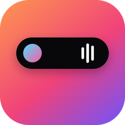

<p align="center"></p>

<h1 align="center">Dynamic Island for Windows</h1>

<p align="center">
An iPhone style Dynamic Island for Windows 10 and 11. Music, timers, notifications and quick settings live in a small pill at the top of your screen that springs open when you need it.<br>
Native C# and WPF, real spring physics, near zero CPU when idle.
</p>

<p align="center"><b><a href="../../releases/latest">Download the latest release</a></b></p>

## Install

1. Open the **[latest release](../../releases/latest)** and download **`DynamicIsland-Setup-<version>-x64.exe`**. On a Snapdragon or other ARM PC, take the `arm64` one.
2. Run it. Because the app isn't code signed yet, Windows may say *"Windows protected your PC"*. Click **More info**, then **Run anyway**.
3. The island appears at the top center of your screen. Click it.

It installs for your account only, so no administrator rights are needed, and .NET is included, so there's nothing else to install. During setup you can choose whether it starts when you sign in.

**Portable:** download `DynamicIsland-<version>-x64-portable.zip`, unzip it anywhere and run `DynamicIsland.exe`. To start it with Windows, turn on Settings › Applications › Start with Windows inside the island.

**Requirements:** Windows 10 version 2004 or newer, or Windows 11, on x64 or ARM64.

## What it does

* **Home widgets:** a large clock card, a battery ring, the music you paused (or your notifications), and a dock of 4 to 6 quick apps you pick in Settings, each on a tile tinted with the app's own colour.
* **Quick controls** without opening Windows Settings: Wi-Fi, Bluetooth, island Do not disturb, dark mode, volume and brightness sliders, switching the speaker or microphone, mic mute, and shortcuts to the pages Windows keeps to itself.
* **Now Playing** for Spotify, YouTube, YouTube Music, JioHotstar, Netflix, Prime Video, VLC and anything else that uses Windows media controls: artwork, title, source, a draggable progress bar, play, pause, skip, volume, and a waveform tinted with the album colour.
* **Several players at once.** Other apps playing in the background are listed under the player; click one and it rises into the main spot. Skipping a track never closes the player while the app loads the next song.
* **Back to the source.** Clicking the artwork takes you to the exact app, window or browser tab that is playing.
* **Camera and microphone indicators:** a green dot inside the island while an app uses the camera, an orange one while an app records from a real, unmuted microphone. Hover for the app's name.
* **Live activities:** stopwatch and countdown timers (start them from the right click menu), and the Windows Clock app's stopwatch mirrored in the island.
* **Notifications** from every app, WhatsApp included, grouped the One UI way: conversations first, everything else below. A short peek when one arrives, then a mini bubble with the app's icon and unread count.
* **System events:** volume, charger plugged in, low battery, Bluetooth headphones connecting.
* **Dashboard:** colourful tabs (Home, Controls, Music, Timer while one runs, Notifications, Settings) with one card at a time. It reopens on the tab you left, and on Music whenever something is playing.
* **Settings inside the island:** searchable, full height, with real system information and controls, and links to the right Windows Settings page for anything Windows doesn't let apps change.
* **Updates in one click.** The island checks GitHub for a new version and shows a banner; Settings › Updates downloads and installs it and restarts the island.
* **Stays out of your way:** it never takes focus, hides during fullscreen games and videos, and tucks into a thin click-through line when a maximized window (like your browser's tabs) sits under it. Rest the pointer on that line and it swells, then opens.

## Using it

| Action | Result |
|---|---|
| Hover the island | Lifts slightly |
| Click the island | Opens the dashboard on whatever is live (music, timer, or Home) |
| Click a bubble or a peek | Opens straight to that app's card, or Music |
| Ctrl+Alt+Space | Opens and closes the island from anywhere |
| Move away | Closes after a short grace period |
| Hold the pointer at the top edge | Brings the island back when it is tucked away |
| Right click | Menu: open, settings, stopwatch, timers, style, start with Windows, quit |

If another app already uses Ctrl+Alt+Space, the island falls back to Alt+Shift+Space. You can pick another shortcut in Settings › Personalization; the right click menu always shows the one in use.

## Privacy

Everything stays on your PC. There are no accounts and no analytics.

* The only network request is the update check: GitHub's public releases API, at startup and every 6 hours. Nothing about you or your PC is sent. Turn it off in Settings › Updates.
* The camera and microphone dots come from Windows' own activity reports (Media Foundation and Core Audio). The island never opens the camera or listens to the microphone.

* Settings, notification history and a log live in `%LOCALAPPDATA%\DynamicIsland`. Settings › Privacy & security can clear the history or open that folder.
* Notification previews use Windows' notification access. If Windows asks, allow it; you can change it later in Windows Settings › Privacy & security › Notifications.
* To find the browser tab that is playing, the island reads tab titles through the Windows accessibility API. It never reads page content.
* It never asks for your location.

## Updating

From 2.0 on, the island updates itself: when a new version is out, a banner appears; click it (or open Settings › Updates) and choose **Install**. It downloads the installer for your PC from the release, checks it against the release, and restarts on the new version. Your settings stay. Version 1.0 has no updater, so install 2.0 once from the [latest release](../../releases/latest).

## Uninstall

Windows Settings › Apps › Installed apps › Dynamic Island › Uninstall. Your settings and history in `%LOCALAPPDATA%\DynamicIsland` are kept; delete that folder to remove them too.

## Build from source

You need the .NET 8 SDK (`winget install Microsoft.DotNet.SDK.8`).

* `run.bat` builds and runs it.
* `install.bat` builds an optimized copy, installs it for your account, and turns on start with Windows.
* `package.bat [version]` builds what a release contains: a self-contained portable zip, plus `Setup.exe` if [Inno Setup](https://jrsoftware.org/isinfo.php) is installed. Output goes to `dist\`.
* `uninstall.bat` removes a copy installed by `install.bat`.

Or open `DynamicIsland.sln` in Visual Studio 2022 or Rider. Logs go to `%LOCALAPPDATA%\DynamicIsland\log.txt`; if something misbehaves, that file says which integration failed.

**Releasing:** push a tag such as `v2.0.1`, or run the *Release* workflow by hand with a version. GitHub Actions builds the x64 and ARM64 installers and portable zips and attaches them to a new Release, using `docs/releases/<version>.md` as the notes when that file exists. Installed islands find the release on their next check.

## Why it feels smooth

* **The window never resizes during animation.** Most Windows overlays resize their window every frame, which stutters. Here the window is a fixed transparent canvas and only the shape inside it moves. Transparent pixels pass clicks through to whatever is underneath.
* **Springs, not easing curves.** `Animation/Spring.cs` is a damped harmonic oscillator using SwiftUI's own parameters (response and damping fraction). Retargeting mid flight keeps velocity, so if you open, close and open again quickly, the island reverses smoothly instead of restarting.
* **Measured tuning.** Expanding settles in about 380 ms with roughly 3% overshoot. Collapsing settles in about 270 ms with essentially none.
* **Frame rate independent.** Springs integrate in fixed 1/480 s steps, so motion is identical at 60, 120 or 144 Hz and survives dropped frames.
* **Zero idle cost.** The render hook is attached only while something is moving. Timers, the waveform meter and the progress bar only tick while they are on screen. Media, volume, power, Bluetooth and window changes are all push events.
* **Content that materializes.** Views fade, scale and unblur into the shape slightly after it starts moving.

## Project layout

```
src/DynamicIsland/
  Animation/   Spring, SpringSystem (render loop), SpringEase, ContentTransition
  Controls/    AudioBars and AudioMeter (waveform), BatteryGlyph, ProgressRing, SlimSlider, PillSlider
  Core/        IslandState (decides the mode), ActivityManager, NotificationManager, Dashboard, QuickApps,
               settings, logging
  Interop/     Win32: no-activate tool window, glass backdrop, shortcut, fullscreen detection
  Services/    Media (sessions, source detection, browser tabs), Audio, Power, Bluetooth, Notifications,
               Timers, Clock app stopwatch, Quick controls, camera and mic monitor, Updates,
               window watcher for tuck away, device info, AutoStart
  Themes/      Styles.xaml: colours, icons, buttons, dark context menu
  Views/       Compact, Expanded (dashboard), Toast, Peek, Settings, bubbles
  MainWindow   Turns state into springs and transitions, handles input
installer/     Inno Setup script for Setup.exe
.github/       Build check on every push, and the release workflow
```

Services raise events, `IslandState` turns them into one mode using the same priority order as iOS (Settings, then the open dashboard, then banners, peeks, live activities, idle), and `MainWindow` animates to it.

## Known limits

* **Not code signed yet,** so Windows SmartScreen warns on first run (see Install).
* **Primary monitor only** for now.
* **Notification access:** some Windows builds only allow packaged (MSIX) apps to read notifications. If access is refused, previews switch off and the log says why; everything else keeps working.

## License

[MIT](LICENSE). Copyright (c) 2026 Swastik Verma.
